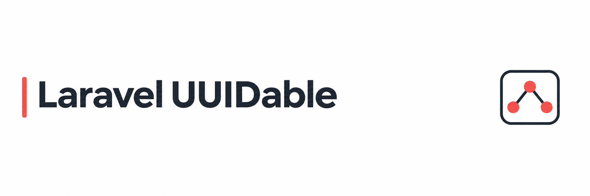

<div align="center">



[](https://packagist.org/packages/evanschleret/laravel-uuidable)
[](https://github.com/EvanSchleret/laravel-uuidable/actions/workflows/tests.yml)
[](https://packagist.org/packages/evanschleret/laravel-uuidable)
[](https://packagist.org/packages/evanschleret/laravel-uuidable)
[](README.md#requirements)
[](https://packagist.org/packages/evanschleret/laravel-uuidable)

</div>

# Laravel UUIDable

Make Eloquent models UUID-ready with automatic UUID generation, query scopes, and route binding that respects explicit route keys.

## Requirements

- PHP 8.3 or later
- Laravel 12 or 13

## Installation

Install the package with Composer:

```bash
composer require evanschleret/laravel-uuidable
```

Laravel discovers the service provider automatically. To publish the package configuration, run:

```bash
php artisan vendor:publish --tag=uuidable-config
```

## Usage

### Add a UUID column

Add a UUID column to the model's table, then use `HasUuid`. The model keeps its regular `id` primary key and receives a UUID in the `uuid` column when it is created.

```php
use EvanSchleret\LaravelUuidable\Concerns\HasUuid;
use Illuminate\Database\Eloquent\Model;

class Post extends Model
{
    use HasUuid;
}
```

The configured UUID column can be queried with `whereUuid` and `whereNotUuid`:

```php
$post = Post::whereUuid($uuid)->first();
$otherPosts = Post::whereNotUuid([$firstUuid, $secondUuid])->get();
```

### Use UUIDs in route binding

Use `HasRoutableUuid` to generate the UUID column and use it for implicit route model binding:

```php
use EvanSchleret\LaravelUuidable\Concerns\HasRoutableUuid;
use Illuminate\Database\Eloquent\Model;

class Post extends Model
{
    use HasRoutableUuid;
}
```

The route `{post}` resolves by UUID. An explicit route key such as `{post:id}` continues to use Laravel's normal binding for `id`.

For separate opt-in, combine `HasUuid` and `BindsToUuid`:

```php
use EvanSchleret\LaravelUuidable\Concerns\BindsToUuid;
use EvanSchleret\LaravelUuidable\Concerns\HasUuid;

class Post extends Model
{
    use HasUuid, BindsToUuid;
}
```

### Use a UUID primary key

Define the `id` column as a UUID primary key and use `HasUuidPrimaryKey`. The trait configures Eloquent to use a string, non-incrementing key.

```php
use EvanSchleret\LaravelUuidable\Concerns\HasUuidPrimaryKey;
use Illuminate\Database\Eloquent\Model;

class User extends Model
{
    use HasUuidPrimaryKey;
}
```

The package does not modify database migrations. Define the UUID column in your application's migration.

## Migrate from another UUID integration

The `uuidable:migrate` command updates supported Eloquent trait imports and trait declarations in your application:

```bash
php artisan uuidable:migrate --dry-run
php artisan uuidable:migrate --from=dyrynda --dry-run
php artisan uuidable:migrate --from=dyrynda --force
```

Without `--from`, the command opens a console selector for the supported profiles. External packages present in `composer.lock` are suggested first. You can select more than one profile. In non-interactive environments, pass `--from` explicitly; use `--force` to apply changes without a confirmation prompt.

The built-in profiles are `dyrynda` (`dyrynda/laravel-model-uuid`), `saade` (`saade/laravel-uuid`), `kblais` (`kblais/laravel-uuid`), `kduma` (`kduma/eloquent-uuidable`), and `laravel` (Laravel's native `HasUuids`). The command scans `app`, `config`, `database`, `routes`, and `tests` by default. Use repeatable `--path` options to scan other project-relative paths.

The command changes PHP trait imports and declarations only. It does not alter database migrations, UUID column data, package dependencies, generation settings, casts, or custom model behavior. It reports source-specific settings that need review. A profile that encounters syntax it cannot safely convert is left unchanged, and the command does not write any files if such a file is found.

Migration profiles are configured in `config/uuidable.php`. Additional profiles can implement `EvanSchleret\LaravelUuidable\Console\Migration\MigrationProfile` and be added to `migration_profiles`.

## Configuration

The default configuration is:

```php
return [
    'generation' => 'v7',
    'column' => 'uuid',
];
```

UUIDv7 is generated by default. Set `generation` to `v1`, `v4`, `v6`, `v7`, or `ordered` to select another strategy. The `ordered` strategy uses Laravel's time-ordered UUIDv4 generator. UUIDv1 and UUIDv6 retain a node field that may expose host information, so prefer UUIDv7 for new applications.

A model can override the generation strategy or additional UUID column:

```php
use EvanSchleret\LaravelUuidable\Enums\UuidGeneration;

protected function uuidColumn(): string
{
    return 'public_id';
}

protected function uuidGeneration(): UuidGeneration
{
    return UuidGeneration::V4;
}
```

The package supports one UUID column per model and stores UUIDs as text. Values assigned to the UUID column before model creation are preserved.

## Contributing

See [CONTRIBUTING.md](CONTRIBUTING.md) for local setup and contribution guidance.

## Security

See [SECURITY.md](SECURITY.md) for private vulnerability reporting instructions.

## License

Laravel UUIDable is open-sourced under the [MIT license](LICENSE).
